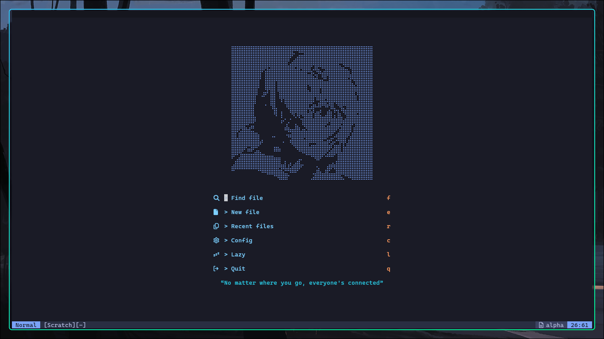
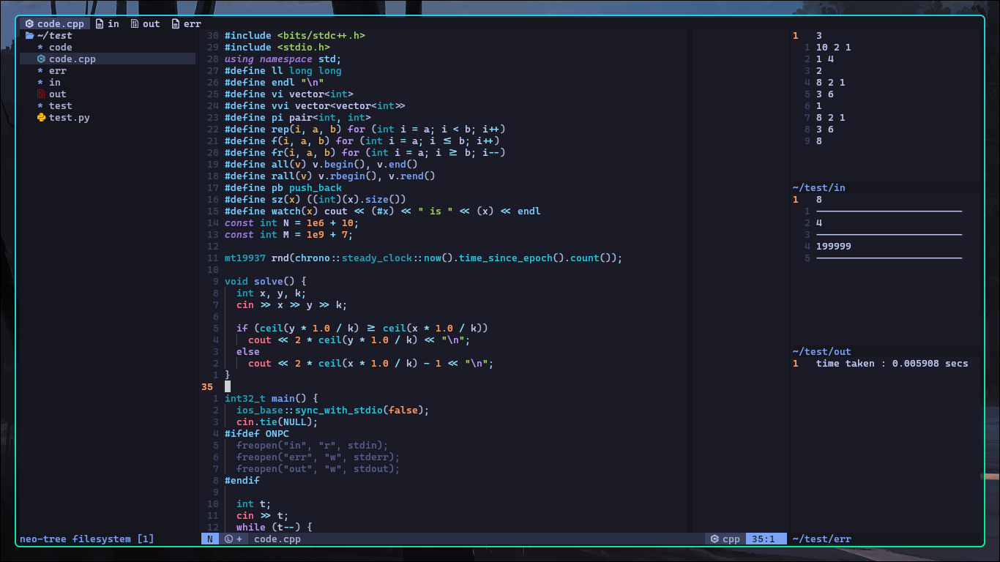
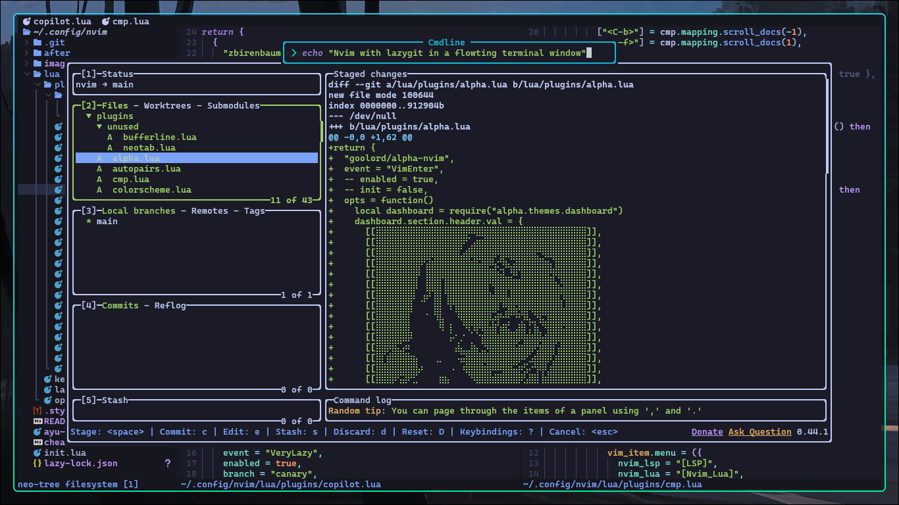

# nvim

Personal Neovim config. Started from kickstart.nvim; the structure has since been reworked around two profiles that share one repo.

## Profiles

| Profile          | Selected by                                            | Contents                                                                                                                                                                                                      |
| ---------------- | ------------------------------------------------------ | ------------------------------------------------------------------------------------------------------------------------------------------------------------------------------------------------------------- |
| `full` (default) | `NVIM_PROFILE` unset, or anything other than `minimal` | Everything: LSP + Mason (blink.cmp, copilot, conform, nvim-lint), telescope, trouble, diffview, DAP, LaTeX, tree-sitter context and autotag, image previews                                                   |
| `minimal`        | `NVIM_PROFILE=minimal`                                 | Editor and navigation essentials: treesitter, neo-tree, mini, faster.nvim, smart-splits, gitsigns, noice, which-key, suda, render-markdown — no LSP/Mason, no completion, no telescope, no debugger, no LaTeX |

Detection lives in `lua/config/profile.lua` and is read once at startup. Set `NVIM_PROFILE=minimal`
in the shell env of the machines that should run minimal (e.g. a line in `~/.zshenv`). Specs that are
full-only carry `enabled = require("config.profile").full`, so they're neither loaded nor installed
on minimal.

## Requirements

Both profiles:

- Neovim 0.12+
- git, ripgrep, curl, tar, gzip, make
- a C compiler and `tree-sitter-cli` >= 0.26.1 — nvim-treesitter builds parsers on the machine

`full` only:

- node/npm (prettierd and the JS/TS servers), go, python3 (debugpy)
- `perl-yaml-tiny` and `perl-file-homedir` — latexindent, used for LaTeX formatting
- a TeX distribution with `latexmk` (vimtex compiles), `chktex` (texlab lints) and `latexindent`
  (Arch: `texlive-binextra`), plus `zathura` with a PDF backend for `:VimtexView`
- ImageMagick (`magick`) — image.nvim
- a Nerd Font

Mason installs the language servers and tools (stylua, prettierd, shellcheck, the debug adapters)
into `~/.local/share/nvim/mason` on the first `full` launch.

## Terminal and tmux

Nothing here needs a specific terminal. These integrations need settings outside this repo:

tmux (`~/.config/tmux/tmux.conf`):

```tmux
set -s extended-keys on                  # nvim requests extended keys; without this, C-; and friends never arrive
set -as terminal-features 'xterm*:extkeys'
set -g set-clipboard on                  # OSC 52, the clipboard path used over SSH
set -s get-clipboard request
set -g allow-passthrough on              # lets image previews reach kitty through tmux
```

Moving from nvim into a shell pane with `C-h`/`C-j`/`C-k`/`C-l` needs the smart-splits tpm plugin
(`set -g @plugin 'smart-splits-nvim/smart-splits.nvim'`), which marks panes with `@pane-is-vim` and
honours its `@smart-splits_*_key` variables. nvim→tmux navigation and resizing work without it.

## Git

lazygit and terminal git use delta. `git-delta` (`pacman -S git-delta`) plus, in
`~/.config/git/config`:

```ini
[core]
  pager = delta
[interactive]
  diffFilter = delta --color-only
[delta]
  navigate = true
[merge]
  conflictStyle = zdiff3
```

## Installation

```sh
git clone https://github.com/ugly-custard/nvim.git ~/.config/nvim
```

The first launch bootstraps lazy.nvim and installs the plugins; on `full` it also installs the Mason
packages. `:Lazy sync` updates both. On a VPS, update plugins on a dev machine only:

```sh
git restore lazy-lock.json && git pull   # then, inside nvim:
:Lazy restore
```

Minimal drops the lock entries of helpers nested under full-only plugins, so don't commit the
lockfile from a VPS.

## Layout

```
init.lua                              leaders, then config/{options,keymaps,autocmds,lazy}
lua/config/profile.lua                full/minimal detection
lua/config/*.lua                      options, keymaps, autocmds, lazy.nvim setup
lua/plugins/<category>/<plugin>.lua   one file per plugin
```

lazy.nvim imports the five category directories (`ui`, `editor`, `tool`, `completion`, `lang`)
explicitly, so a new category needs a line in `lua/config/lazy.lua`. Plugin keymaps live in the
spec's `keys` field — lazy.nvim binds them and loads the plugin on use. Buffer-local keymaps
(gitsigns, smart-splits, blink, neoscroll) are set inside the spec instead.

## Keymaps

`<leader>` is `<space>`, `<localleader>` is `\`. Press `<leader>?` for which-key to browse the rest,
or read `lua/config/keymaps.lua` for the general maps and the `keys` field of each plugin file. Keys
that come from full-only plugins (telescope, DAP, trouble, conform, grug-far) don't exist on minimal.

| Key                                        | Action                                                        |
| ------------------------------------------ | ------------------------------------------------------------- |
| `<leader>sf` / `<leader>sg` / `<leader>sw` | Find files / live grep / grep word                            |
| `<leader>sR`                               | Search & replace in project (grug-far)                        |
| `\`                                        | Toggle neo-tree                                               |
| `<leader>f`                                | Format buffer or selection                                    |
| `<leader>rn` / `<leader>ca` / `gd` / `gr`  | Rename / code action / definition / references                |
| `<leader>xx` / `<leader>b` / `<leader>B`   | Trouble diagnostics / DAP breakpoint / conditional breakpoint |
| `<C-\>` / `<leader>gg`                     | Terminal / lazygit                                            |
| `<leader>;` / `[;` / `];`                  | Breadcrumbs: pick, start of context, next context             |
| `<leader>zZ`                               | Zen mode                                                      |
| `]t` / `[t`                                | Next / previous TODO                                          |
| `<A-h>` `<A-l>` / `<A-j>` `<A-k>`          | Move tab / move line or selection                             |
| `<Esc><Esc>`                               | Leave terminal mode (for scrollback)                          |

## Looks




